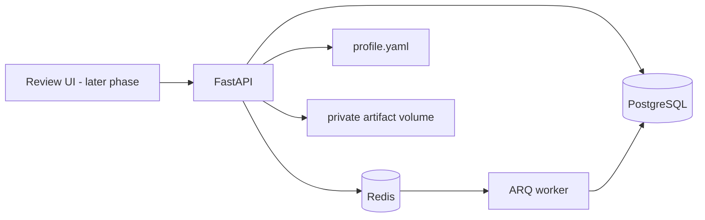

# Job Application Agent

A local workflow assistant for finding and reviewing job opportunities, verifying posting evidence, generating profile-backed documents, and recording application-specific human approval. Submission remains a later phase.

## Architecture

PostgreSQL is the durable record; Redis is the queue/cache layer. ARQ was selected for the initial workload because it is async-native and uses the Redis service already required, with fewer operational components than Celery. Queue jobs must remain safe to retry; consequential workflow state is persisted in PostgreSQL.

## Project layout

`app/domain` contains Pydantic workflow contracts and transition rules; `app/db` contains persistence models; `app/profile` loads the authoritative YAML profile; `app/audit` redacts audit payloads; `app/discovery` contains public ATS source adapters, freshness checks, URL normalization, and persistence; `app/matching` contains deterministic scoring; `app/verification` assesses listing evidence; `app/llm` provides structured job-description extraction; `app/documents` builds, validates, renders, and privately stores application documents; `app/workers` configures ARQ; `migrations` contains schema migrations; `tests` contains deterministic fixture tests.

## Local setup

Requirements: Docker Desktop with Compose. Python 3.12 is needed for running tests outside Docker.

1. Copy `.env.example` to `.env` and replace `APP_SECRET_KEY` with a long random value.
2. Populate `profile.yaml` with verified facts. Keep personal profile files out of source control when practical.
3. Start services: `docker compose up --build -d`
4. Apply schema: `docker compose exec api alembic upgrade head`
5. Check API liveness: `http://localhost:8000/health/live`; readiness: `http://localhost:8000/health/ready`.
6. Stop services: `docker compose down`.

Database and Redis data persist in Compose volumes. To reset a development database and queue, `docker compose down -v` removes those named volumes and their data.

For local Python setup, create a Python 3.12 virtual environment, then run `python -m pip install -e '.[dev]'`. Apply migrations with `alembic upgrade head`; run tests with `python -m pytest`.

## Discovery and matching (Phase 2)

Configure public job boards using `DISCOVERY_BOARDS` in `.env`, with semicolon-separated entries such as `greenhouse:acme;lever:acme;ashby:Acme`. A board token/site/board name must be known; these endpoints do not provide cross-employer search. The ARQ worker runs configured board discovery at startup and daily at 07:00 UTC. Only explicitly listed boards are queried. Workable's current documented job API requires an employer-generated API token with the `r_jobs` scope, so it is not treated as a generally public source in this release.

Greenhouse's public Job Board API supports unauthenticated GET requests for published jobs and descriptions. The adapter uses `first_published` when the board supplies it and never treats `updated_at` as publication time. Lever's public Postings API returns published postings but its documented response does not specify a publish timestamp, so those dates remain unknown. Ashby's public Job Postings API supplies `publishedAt`. Unknown or older dates are excluded. Posting pages are live-checked only when they use supported ATS hosts; redirects and unknown hosts are excluded pending a safe verification path.

The deterministic match score considers skill overlap, target role, experience/seniority, workplace/location preferences, work-authorization evidence when the location gives a direct country match, and compatible disclosed salary. It returns an explanation, matched/missing profile skills, and explicit conflicts. Unknown job data remains uncertain. The score is a ranking aid and does not decide whether an application is submitted.

## Employer and posting verification (Phase 3)

Discovery runs a deterministic evidence assessment after new source data is saved. It stores the classification, support/risk totals, individual weighted signals, evidence URLs, reliability, timestamps, missing evidence, uncertainty, and policy version/parameters. `VERIFIED` requires the configured minimum score and successful recognized-ATS-feed, original-link, and ATS-host evidence. `PROBABLE` remains in `DISCOVERED` for human review. `SUSPICIOUS` moves a pre-submission application to `REJECTED_BY_VERIFICATION`. Thresholds default to 70 for verified and 40 risk points for suspicious; set `VERIFICATION_VERIFIED_THRESHOLD` and `VERIFICATION_SUSPICIOUS_RISK_THRESHOLD` to override them.

The verification score means the posting was supported by accessible ATS evidence. It does not establish that the employer is trustworthy. Current scoring rules and limitations are documented in [docs/verification-methodology.md](docs/verification-methodology.md).

Official source documentation: [Greenhouse Job Board API](https://docs.greenhouse.io/job-board), [Lever public Postings API](https://github.com/lever/postings-api), [Ashby Job Postings API](https://developers.ashbyhq.com/docs/public-job-posting-api).

## Document generation (Phase 4)

The document service extracts structured job requirements and uses them only to rank profile facts. A deterministic claim check validates every personal statement against the profile before creating the four versioned files (CV and cover letter in PDF and DOCX). Artifacts are stored in the private Docker volume; they have no public file API. The service transitions `SHORTLISTED` applications to `CV_GENERATED` after successful validation. It supports a deterministic mock provider and optional Claude, Gemini, or Groq structured-output providers. Provider setup, data handling, and limitations are in [docs/documents-and-claims.md](docs/documents-and-claims.md).

## Approval dashboard (Phase 5)

Open `http://localhost:8000` after setting `DASHBOARD_PASSWORD` in `.env`. The local dashboard uses signed, HTTP-only, same-site session cookies, CSRF tokens on every form mutation, and server-side authorization for document access. It shows job details, verification signals and uncertainty, match score, CV and cover-letter previews, private downloads, profile-data disclosure, screening-question review, state history, and per-application skip/review/approve actions. Editing the structured source creates a new validated version and clears any previous approval. Approval requires a passing claim check and all collected screening answers resolved; approval does not submit an application.

The UI is server-rendered HTML with native forms and a small local stylesheet instead of React or HTMX. For this single-user local dashboard, this avoids a separate JavaScript build, external browser dependencies, and cross-origin API calls while keeping the review and approval boundary on the server. The API port binds to `127.0.0.1` in Compose. Set a unique password in `.env`; production configuration requires a 24-character dashboard password and 32-character session secret, and enables secure cookies. Configure TLS before exposing a production deployment through a reverse proxy.

See [docs/approval-dashboard.md](docs/approval-dashboard.md) for authentication behavior, review flow, and security limitations.

## Hosted application form submission (Phase 6)

Submission is limited to supported Greenhouse and Lever hosted forms. The dashboard first inspects the page without entering applicant data, saves a preview bound to the active approval, document version, profile hash, verification, and reviewed screening answers, then requires a separate **Submit application now** confirmation. It stops on login, CAPTCHA, unknown or ambiguous fields, changed forms, unsupported hosts, or validation errors. Unsupported application flows must be completed manually.

Rebuild the Docker image after updating dependencies so it installs Playwright and Chromium. Submission screenshots are stored under the private artifacts directory; a screenshot alone never confirms success. The application becomes `SUBMITTED` only after the hosted page displays an explicit confirmation marker. If the result is uncertain, the application is locked against retry until you check the employer site and record a manual reconciliation.

Greenhouse's application API requires an employer-specific API key, and Lever's custom posting API requires a Super Admin-generated key. This project does not request or store those employer credentials; it uses the supported hosted form and stops when it cannot safely understand it. See [Greenhouse Job Board API](https://docs.greenhouse.io/job-board) and [Lever Postings API](https://github.com/lever/postings-api).

The automated test suite uses synthetic form snapshots and does not submit real applications. Browser integration requires a running Docker stack and a user-triggered dashboard submission; do not use a live job application as a test fixture.

## Application tracking and follow-ups (Phase 7)

Every confirmed submission gets one idempotent follow-up reminder, defaulting to seven days after the confirmed timestamp. Change `FOLLOW_UP_DAYS` in `.env` to a value from 1 to 90; the worker checks the reminder queue at 08:00 UTC and creates a saved, editable draft when a reminder is due. The draft uses only the employer, role, confirmed submission date, and profile name, and requires your approval. The dashboard does not send email or calendar messages. After sending or handling the message yourself, mark it handled in the application record. Application notes and the event history stay in the authenticated dashboard.

After Phase 7 changes, rebuild and migrate with `docker compose up -d --build` and `docker compose exec api alembic upgrade head`. See [docs/tracking-and-hardening.md](docs/tracking-and-hardening.md) for status behavior, recovery, privacy, and deployment limitations.

## Included phases

- Phase 1: FastAPI, PostgreSQL, Redis, ARQ, profile contracts, state machine, audit helper, health checks.
- Phase 2: Public Greenhouse, Lever, and Ashby discovery, freshness filtering, deduplication, and deterministic matching.
- Phase 3: Posting evidence assessment and persisted verification records.
- Phase 4: Structured job description analysis, exact profile-backed CV/cover-letter content, claim validation, PDF/DOCX rendering, private versioned storage, and audit records.
- Phase 5: Authenticated dashboard, job/evidence review, document preview/editing, screening review, disclosure summary, and explicit approval gate.
- Phase 6: Allowlisted Greenhouse and Lever hosted-form inspection, exact-field preview and explicit submission, durable attempt locking, confirmation evidence, and manual reconciliation for uncertain outcomes.
- Phase 7: Durable application notes and follow-up history, configurable idempotent reminders, worker-generated editable drafts, explicit draft approval, and manual completion tracking.

## Security and operations

Do not commit `.env`, populated profile data, generated documents, or browser evidence. Artifacts are mounted to a private Docker volume. Audit payloads redact keys resembling secrets and mask email addresses, but callers must still minimize payloads. Audit append-only behavior is an application convention in this phase; database-level tamper-evidence and retention controls remain future hardening work. Back up PostgreSQL and the artifact volume together, and test restore procedures before relying on the system.

External source terms, provider APIs, ATS forms, and access rules will be checked when each integration is implemented. Automated verification can evaluate a posting's evidence; it cannot guarantee that an employer is trustworthy.

