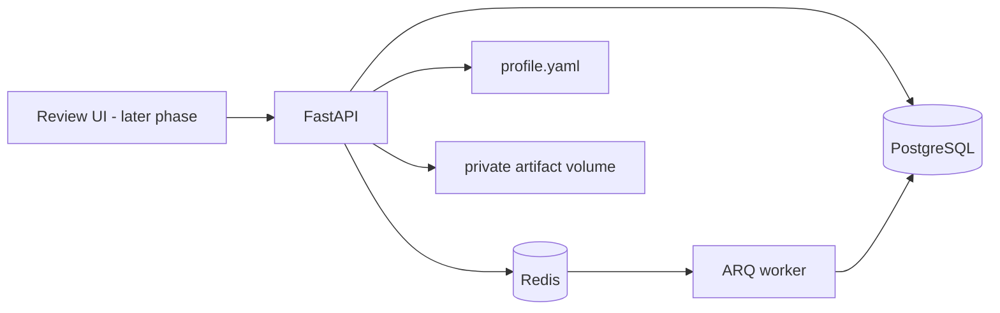

# Job Application Agent

Phase 1 establishes the local foundation for an application workflow that uses verified profile facts and requires explicit human approval before submission. Discovery, verification, document generation, dashboard actions, and ATS submission are not implemented in this phase.

## Architecture

PostgreSQL is the durable record; Redis is the queue/cache layer. ARQ was selected for the initial workload because it is async-native and uses the Redis service already required, with fewer operational components than Celery. Queue jobs must remain safe to retry; consequential workflow state is persisted in PostgreSQL.

## Project layout

`app/domain` contains Pydantic workflow contracts and transition rules; `app/db` contains persistence models; `app/profile` loads the authoritative YAML profile; `app/audit` redacts audit payloads; `app/workers` configures ARQ; `migrations` contains schema migrations; `tests` contains deterministic foundation tests. Later phases add discovery, matching, verification, document, approval, submission, tracking, and dashboard modules.

## Local setup

Requirements: Docker Desktop with Compose. Python 3.12 is needed for running tests outside Docker.

1. Copy `.env.example` to `.env` and replace `APP_SECRET_KEY` with a long random value.
2. Populate `profile.yaml` with verified facts. Keep personal profile files out of source control when practical.
3. Start services: `docker compose up --build -d`
4. Apply schema: `docker compose exec api alembic upgrade head`
5. Check API liveness: `http://localhost:8000/health/live`; readiness: `http://localhost:8000/health/ready`.
6. Stop services: `docker compose down`.

Database and Redis data persist in Compose volumes. To reset a development database and queue, `docker compose down -v` removes those named volumes and their data.

For local Python setup, create a Python 3.12 virtual environment, then run `python -m pip install -e '.[dev]'`. Apply migrations with `alembic upgrade head`; run tests with `python -m pytest`.

## Phase 1 scope

Included: Docker services for FastAPI, PostgreSQL, Redis, and ARQ; environment-backed settings; foundational database entities and migration; Pydantic profile and workflow models; explicit state transition validation; redaction helper for audit payloads; liveness/readiness endpoints.

Not yet included: authenticated review UI, profile API, a complete transition repository/service, live discovery, LLM providers, document renderers, verification scoring, submission adapters, reminder scheduling, and production secrets/session management. No real job application is submitted by this foundation.

## Security and operations

Do not commit `.env`, populated profile data, generated documents, or browser evidence. Artifacts are mounted to a private Docker volume. Audit payloads redact keys resembling secrets and mask email addresses, but callers must still minimize payloads. Audit append-only behavior is an application convention in this phase; database-level tamper-evidence and retention controls remain future hardening work. Back up PostgreSQL and the artifact volume together, and test restore procedures before relying on the system.

External source terms, provider APIs, ATS forms, and access rules will be checked when each integration is implemented. Automated verification can evaluate a posting's evidence; it cannot guarantee that an employer is trustworthy.

