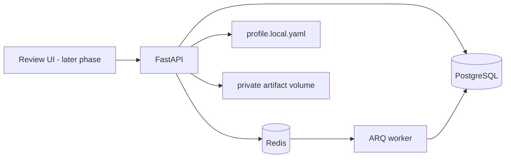

# Job Application Agent

A local workflow assistant for finding and reviewing job opportunities, verifying posting evidence, generating profile-backed documents, and recording application-specific human approval. Submission remains a later phase.

## Architecture



PostgreSQL is the durable record; Redis is the queue/cache layer. ARQ was selected for the initial workload because it is async-native and uses the Redis service already required, with fewer operational components than Celery. Queue jobs must remain safe to retry; consequential workflow state is persisted in PostgreSQL.

## Project layout

`app/domain` contains Pydantic workflow contracts and transition rules; `app/db` contains persistence models; `app/profile` loads the authoritative YAML profile; `app/audit` redacts audit payloads; `app/discovery` contains public ATS source adapters, freshness checks, URL normalization, and persistence; `app/matching` contains deterministic scoring; `app/verification` assesses listing evidence; `app/llm` provides structured job-description extraction; `app/documents` builds, validates, renders, and privately stores application documents; `app/workers` configures ARQ; `migrations` contains schema migrations; `tests` contains deterministic fixture tests.

## Local setup

Requirements: Docker Desktop with Compose. Python 3.12 is needed for running tests outside Docker.

1. Copy `.env.example` to `.env`. Generate `APP_SECRET_KEY`, `POSTGRES_PASSWORD`, and `REDIS_PASSWORD` with `python -c "import secrets; print(secrets.token_urlsafe(48))"`; use a distinct generated value for each. Set a unique `DASHBOARD_PASSWORD`.
2. Copy the tracked, blank `profile.example.yaml` to the ignored `profile.local.yaml` and populate that local copy with verified facts. Docker Compose mounts the local file into the containers. For direct Python runs, set `PROFILE_PATH=profile.local.yaml`.
3. Start only the data services: `docker compose up -d db redis`.
4. Apply schema migrations before starting the worker: `docker compose run --build --rm api alembic upgrade head`.
5. Start the API and worker: `docker compose up --build -d api worker`.
6. Check API liveness: `http://localhost:8000/health/live`; readiness: `http://localhost:8000/health/ready`.
7. Stop services: `docker compose down`.

Database and Redis data persist in Compose volumes. To reset a development database and queue, `docker compose down -v` removes those named volumes and their data.

Compose requires the generated `POSTGRES_PASSWORD` and `REDIS_PASSWORD` values from `.env`; it builds the container connection URLs from them and requires Redis authentication. PostgreSQL and Redis development ports bind to `127.0.0.1`; keep them off public interfaces in production. Production startup rejects placeholder session/database/Redis credentials and unknown `APP_ENV` values. If using a reverse proxy, set `FORWARDED_ALLOW_IPS` to the proxy's exact IP addresses; do not trust arbitrary forwarded headers.

For local Python setup, create a Python 3.12 virtual environment, then run `python -m pip install -e '.[dev]'`. Apply migrations with `alembic upgrade head`; run tests with `python -m pytest`.

## CI/CD with GitHub Actions and Render

The GitHub Actions workflow at `.github/workflows/ci.yml` runs for pull requests targeting `main` and for pushes to `main`. It installs the application and development dependencies, runs the test suite, and builds the production Docker image. It does not need production credentials, profile data, a live database, or API keys.

Connect the GitHub repository to each Render application service (web/API and background worker), and set each service's branch to `main`. In each service's **Settings → Auto-Deploy**, select **After CI Checks Pass**. Render then deploys the commit only after the GitHub Actions check succeeds. Configure the Render PostgreSQL and Redis URLs, production secrets, and the `profile.yaml` Secret File independently in Render; add the profile Secret File to both services and set `PROFILE_PATH=/etc/secrets/profile.yaml`. Keep `.env` and `profile.local.yaml` out of Git.

Render Free supports a web service but not a background worker. Without a separately running ARQ worker, scheduled discovery and follow-up drafting do not run, so the dashboard can be healthy but contain no applications. Free web-service filesystems are ephemeral; generated PDFs stored locally can disappear after a restart, spin-down, or redeploy. Use a paid worker and persistent storage or an external artifact store for continuous production use.

For schema-changing releases, set `alembic upgrade head` as the web service's pre-deploy command so the migration completes before the new web version goes live. Render's pre-deploy command requires a paid web service. Run migrations through an appropriate one-off/manual process if the service plan does not provide pre-deploy commands. The worker should not run migrations independently. See Render's docs for [deploying after CI checks pass](https://render.com/docs/deploys), [Docker services](https://render.com/docs/docker), and [secret files](https://render.com/docs/docker-secrets).

## HTTP API and dashboard endpoint reference

The application exposes JSON health endpoints and an authenticated, server-rendered HTML dashboard. Application workflow routes use HTML forms and redirects; they are **not** a public JSON CRUD API. Unless a route is identified as a health check or static asset, it requires the dashboard session. All dashboard mutations require a CSRF token.

### Base URL and common request rules

- Local base URL: `http://localhost:8000` (Compose binds the API to `127.0.0.1`).
- Path parameters named `application_id`, `document_id`, `question_id`, `attempt_id`, or `reminder_id` are UUIDs.
- Form POSTs use `application/x-www-form-urlencoded`, with `csrf_token` copied from the form rendered by the corresponding GET page. The server accepts at most 1 MiB per form body and 100 form fields.
- An unauthenticated dashboard request redirects to `/login` with HTTP `303`. Successful form mutations normally redirect with HTTP `303`; they do not return a JSON resource body.
- Error responses are HTML or FastAPI's standard error response. Common statuses are `403` for an invalid/missing CSRF token, `404` for a missing application or artifact, `409` for a state conflict or stale review, `413` for an oversized form, and `422` for invalid/missing form values. Login failures return `401`; repeated failures are limited to eight per client address in a ten-minute window within each API process.

### Health, docs, and static assets

| Method and path | Authentication | Response |
| --- | --- | --- |
| `GET /health/live` | None | JSON `{"status":"ok"}` with HTTP `200`; confirms the API process responds. |
| `GET /health/ready` | None | JSON `{"status":"ready","environment":"..."}` with HTTP `200`, or `{"status":"not_ready"}` with HTTP `503`. Checks the PostgreSQL connection only; it does not verify Redis, worker health, or migration version. |
| `GET /docs`, `GET /redoc`, `GET /openapi.json` | None | FastAPI's generated API documentation/schema. Dashboard routes are excluded from OpenAPI, so the schema lists health routes, not the HTML form workflows documented here. |
| `GET /static/{path}` | None | Local dashboard CSS/static assets. |

Windows quick checks:

```powershell
curl.exe -i http://localhost:8000/health/live
curl.exe -i http://localhost:8000/health/ready
```

### Sign-in and dashboard navigation

| Method and path | Request | Success |
| --- | --- | --- |
| `GET /` | No body | Redirects to `/dashboard` if signed in, otherwise `/login` (`303`). |
| `GET /login` | No body | Sign-in HTML with a session-bound hidden `csrf_token`. If `DASHBOARD_PASSWORD` is unset, returns a setup page instead. |
| `POST /login` | Form fields: `csrf_token`, `password` | On success, rotates the session and redirects to `/dashboard` (`303`). Wrong password returns `401`; missing/invalid token returns `403`; rate limit returns `429`; unset password returns `503`. |
| `POST /logout` | Authenticated form field: `csrf_token` | Clears the session and redirects to `/login` (`303`). |
| `GET /dashboard` | Optional query: `state` | Applications queue HTML. `state` must be one of `DISCOVERED`, `VERIFIED`, `SHORTLISTED`, `CV_GENERATED`, `AWAITING_APPROVAL`, `APPROVED`, `SUBMITTED`, `FOLLOW_UP`, `REJECTED_BY_VERIFICATION`, or `SKIPPED`; unknown values return `422`. |
| `GET /follow-ups` | No body | Follow-up reminder list HTML, including status and scheduled timestamp in UTC. |
| `GET /applications/{application_id}` | UUID path parameter | Application detail HTML: job and verification evidence, match details, document versions, screening questions, approval/submission status, notes, reminders, and state history. |
| `POST /applications/{application_id}/shortlist` | Form: `csrf_token`, checked `confirm=yes` | Manually moves a `VERIFIED` application to `SHORTLISTED` after rechecking the latest posting assessment. Redirects to application detail (`303`). |
| `POST /applications/{application_id}/generate-documents` | Form: `csrf_token`, checked `confirm=yes` | Generates profile-backed CV and cover-letter PDF/DOCX files for a shortlisted application, validates claims, saves a private version, and moves it to `CV_GENERATED`. Redirects to detail (`303`); stale state returns `409`, provider failure `502`, and generation/claim failure `422`. |
| `POST /applications/{application_id}/delete` | Authenticated form: `csrf_token`, checked `confirm_delete=yes` | Hides an unused job from the dashboard and future discovery while retaining its history, records a `job.deleted` audit event, and redirects to `/dashboard` (`303`). Offered for discovered, verified, rejected, and skipped listings; shortlisted jobs and records with saved review/submission activity cannot be hidden (`409`). |

Use **Delete** in the dashboard row to hide a listing you no longer want. Check **Hide and keep history** to confirm. Hidden listings remain in the database as deduplication tombstones, so scheduled discovery does not recreate them; application, verification, source, and audit history are retained.

### Application documents and screening review

| Method and path | Request | Success and behavior |
| --- | --- | --- |
| `GET /applications/{application_id}/documents/{slug}` | Optional query: `version` (positive document version), `inline=1` | Authenticated file response. `slug` is `cv-pdf`, `cv-docx`, `cover-letter-pdf`, or `cover-letter-docx`. Without `version`, returns the latest version. PDFs display inline only when `inline=1`; otherwise files download. Missing/invalid document returns `404`. |
| `POST /applications/{application_id}/documents/{document_id}/revise` | Form: `csrf_token`, `content_json` (JSON-encoded `ApplicationDocumentContent`) | Validates profile-backed CV/cover-letter claims and saved job identity, creates an immutable document version, and invalidates prior approval. Redirects to application detail (`303`); validation errors return an HTML `422` page. Editing is blocked while submission outcome is locked or the application is terminal. |
| `POST /applications/{application_id}/screening/{question_id}/review` | Form: `csrf_token`, and either `profile_path` (exact non-empty profile fact path) or `needs_clarification=yes` | Stores a reviewed answer or marks it as needing clarification, records an audit event, and redirects to application detail (`303`). Only `CV_GENERATED` and `AWAITING_APPROVAL` applications can be changed; invalid state returns `409`, invalid fact selection returns `422`. |

`content_json` must match the strict `ApplicationDocumentContent` model in `app/documents/models.py`: top-level `cv`, `cover_letter`, `job_analysis`, and `cover_letter_word_count`; unknown fields are rejected. The document route is for the structured source and does not accept arbitrary generated file uploads.

### Approval and application state actions

| Method and path | Form fields | Success and behavior |
| --- | --- | --- |
| `POST /applications/{application_id}/request-approval` | `csrf_token` | Moves an eligible generated application to `AWAITING_APPROVAL`; redirects to detail (`303`). Ineligible applications return `409`. |
| `POST /applications/{application_id}/approve` | `csrf_token`, `confirm=yes`, `document_version`, `verification_id`, `answers_hash` | Records explicit per-application approval only if the latest verified posting, claim-checked document, and screening-answer snapshot still match. Redirects to detail (`303`); stale or blocked approval returns `409`; missing confirmation returns `422`. |
| `POST /applications/{application_id}/skip` | `csrf_token` | Invalidates active approval, transitions the application to `SKIPPED`, and redirects to `/dashboard` (`303`). Invalid state or submission lock returns `409`. |

Approval is not submission. Submission requires its own form inspection, preview, and final explicit confirmation.

### Hosted-form submission

| Method and path | Form fields | Success and behavior |
| --- | --- | --- |
| `POST /applications/{application_id}/prepare-submission` | `csrf_token` | Opens the allowlisted hosted posting for inspection without entering personal data, then saves a prepared form plan for dashboard review. Redirects to detail (`303`). Unsupported fields, login, CAPTCHA, redirects, or unsafe forms are recorded as a safe pre-submit failure; an active or changed application returns `409`. |
| `POST /applications/{application_id}/submit` | `csrf_token`, `attempt_id`, `confirm=yes` | Revalidates the approval/profile/document/verification snapshot, fills only reviewed supported fields, and invokes the hosted form submit control. Redirects to detail (`303`). A stale plan or unresolved attempt returns `409`; explicit confirmation is required (`422`). The outcome is recorded as confirmed success, confirmed failure, or unknown; unknown outcomes are locked against blind retry. |
| `POST /applications/{application_id}/reconcile-submission` | `csrf_token`, `attempt_id`, `resolution=submitted` or `not_submitted`, `evidence_ref`, `reconcile_confirm=yes` | Records the user's external check for an in-progress/unknown result. `evidence_ref` is required (max 500 characters). A confirmed submission changes the application to `SUBMITTED` and creates its reminder; a confirmed non-submission unlocks it for a later reviewed attempt. Invalid resolution or stale attempt returns `409`/`422`. |
| `GET /applications/{application_id}/submission-evidence/{attempt_id}` | UUID path parameters | Authenticated, private PNG screenshot response with `Cache-Control: no-store`. Returns `404` if no stored evidence exists. |

Supported browser submission hosts are restricted to Greenhouse and Lever hosted application pages. The server does not expose a generic browser-control endpoint and does not bypass CAPTCHA or login. An uncertain result must be reconciled before another attempt.

### Application notes and follow-ups

| Method and path | Form fields | Success and behavior |
| --- | --- | --- |
| `POST /applications/{application_id}/notes` | `csrf_token`, `body` (1–5,000 characters) | Adds an append-only private application note and redirects to detail (`303`). |
| `POST /applications/{application_id}/follow-ups/{reminder_id}/save-draft` | `csrf_token`, `draft_text` (1–5,000 characters) | Saves edits to a draft in `DRAFTED` status. Other statuses return `409`. |
| `POST /applications/{application_id}/follow-ups/{reminder_id}/approve` | `csrf_token`, `draft_text`, `confirm=yes` | Saves and explicitly approves the draft for manual use; it does not send the message. |
| `POST /applications/{application_id}/follow-ups/{reminder_id}/complete` | `csrf_token`, `confirm=yes`, optional `completion_note` (max 1,000 characters) | Records that the user handled the follow-up outside the dashboard. Completes the reminder and transitions `SUBMITTED` to `FOLLOW_UP`. Only an approved draft can be completed. |

The worker creates one reminder only for confirmed submissions. The default delay is seven days (`FOLLOW_UP_DAYS`, range 1–90); due drafts are generated on the daily worker schedule. The dashboard has no email/calendar send endpoint.

### Form workflow examples

For browser-based use, open `/login`, sign in, and use the forms on the application detail page; this preserves the signed session cookie and CSRF tokens. A submission workflow is: approve an application, choose **Inspect supported application form**, review the prepared field/document preview, then separately choose **Submit application now**. A follow-up workflow is: wait for the due draft, edit it if needed, explicitly approve it, send/handle it outside the dashboard, and mark it handled.

## Discovery and matching (Phase 2)

Configure public job sources using semicolon-separated entries in `DISCOVERY_BOARDS`. Supported public feeds are `remoteok`, `remotive`, `jobicy`, and `weworkremotely`; example: `DISCOVERY_BOARDS=remoteok;remotive;jobicy;weworkremotely`. Direct employer ATS boards use `greenhouse:<board>`, `lever:<site>`, or `ashby:<board>` entries, such as `greenhouse:acme;lever:acme;ashby:Acme`. The board/site names must be supplied by the employer's career URL; ATS root URLs alone are not board IDs. The Africa-focused pages and Wellfound URL in the supplied list do not expose a documented public feed used here, so the app does not fetch them. Workable has a public account endpoint, but its URL needs an employer account subdomain; the supplied root URL does not include one. The ARQ worker runs configured discovery once at startup and then at 07:00, 13:00, and 19:00 UTC (08:00, 14:00, and 20:00 West Africa Time). Jobicy's public feed contains remote listings from the last seven days; Remotive requests are subject to its published attribution and 24-hour delay rules; Remote OK and We Work Remotely listings retain their original posting links and source attribution. Aggregated listings are not ATS-verified and remain subject to manual review. The app currently checks global remote-feed listings; confirm that each posting accepts applicants based in Nigeria. See the [Remote OK JSON feed](https://remoteok.com/faq), [Remotive public API](https://remotive.com/remote-jobs/api), [Jobicy public API](https://jobicy.com/jobs-rss-feed), and [We Work Remotely RSS feed](https://weworkremotely.com/remote-job-rss).

Greenhouse's public Job Board API supports unauthenticated GET requests for published jobs and descriptions. The adapter uses `first_published` when the board supplies it and never treats `updated_at` as publication time. Lever's public Postings API returns published postings but its documented response does not specify a publish timestamp, so those dates remain unknown. Ashby's public Job Postings API supplies `publishedAt`. Unknown or older dates are excluded. Posting pages are live-checked only when they use supported ATS hosts; redirects and unknown hosts are excluded pending a safe verification path.

The deterministic match score considers skill overlap, target role, experience/seniority, workplace/location preferences, work-authorization evidence when the location gives a direct country match, and compatible disclosed salary. It returns an explanation, matched/missing profile skills, and explicit conflicts. Unknown job data remains uncertain. The score is a ranking aid and does not decide whether an application is submitted.

## Employer and posting verification (Phase 3)

Discovery runs a deterministic evidence assessment after new source data is saved. It stores the classification, support/risk totals, individual weighted signals, evidence URLs, reliability, timestamps, missing evidence, uncertainty, and policy version/parameters. `VERIFIED` requires the configured minimum score and successful recognized-ATS-feed, original-link, and ATS-host evidence. `PROBABLE` remains in `DISCOVERED` for human review. `SUSPICIOUS` moves a pre-submission application to `REJECTED_BY_VERIFICATION`. Thresholds default to 70 for verified and 40 risk points for suspicious; set `VERIFICATION_VERIFIED_THRESHOLD` and `VERIFICATION_SUSPICIOUS_RISK_THRESHOLD` to override them.

The verification score means the posting was supported by accessible ATS evidence. It does not establish that the employer is trustworthy. Current scoring rules and limitations are documented in [docs/verification-methodology.md](docs/verification-methodology.md).

Official source documentation: [Greenhouse Job Board API](https://docs.greenhouse.io/job-board), [Lever public Postings API](https://github.com/lever/postings-api), [Ashby Job Postings API](https://developers.ashbyhq.com/docs/public-job-posting-api).

## Document generation (Phase 4)

The document service extracts structured job requirements and uses them only to rank profile facts. A deterministic claim check validates every personal statement against the profile before creating the four versioned files (CV and cover letter in PDF and DOCX). Artifacts are stored in the private artifact directory; they have no public file API. In the dashboard, manually shortlist a `VERIFIED` job, then explicitly choose **Generate CV and cover letter**. The service transitions `SHORTLISTED` applications to `CV_GENERATED` after successful validation; it does not generate documents automatically. It supports deterministic mock mode and optional OpenAI, Anthropic Claude, Gemini, Groq, and xAI Grok structured-output providers. Set `LLM_PROVIDER=auto` to use configured API keys in `LLM_AUTO_PRIORITY` order, with automatic fallback if a provider fails; or set one provider and `LLM_MODEL` to pin it manually. Provider-specific model IDs and setup details are in `.env.example` and [docs/documents-and-claims.md](docs/documents-and-claims.md).

## Approval dashboard (Phase 5)

Open `http://localhost:8000` after setting `DASHBOARD_PASSWORD` in `.env`. The local dashboard uses signed, HTTP-only, same-site session cookies, CSRF tokens on every form mutation, and server-side authorization for document access. It shows job details, verification signals and uncertainty, match score, CV and cover-letter previews, private downloads, profile-data disclosure, screening-question review, state history, and per-application skip/review/approve actions. Editing the structured source creates a new validated version and clears any previous approval. Approval requires a passing claim check and all collected screening answers resolved; approval does not submit an application.

The UI is server-rendered HTML with native forms and a small local stylesheet instead of React or HTMX. For this single-user local dashboard, this avoids a separate JavaScript build, external browser dependencies, and cross-origin API calls while keeping the review and approval boundary on the server. The API port binds to `127.0.0.1` in Compose. Set a unique password in `.env`; production configuration requires at least six characters with at least four distinct characters, and a 32-character session secret. Six characters is a low security floor; use a much longer password for any internet-accessible deployment. Production enables secure cookies, so configure TLS before exposing the dashboard through a reverse proxy.

See [docs/approval-dashboard.md](docs/approval-dashboard.md) for authentication behavior, review flow, and security limitations.

## Hosted application form submission (Phase 6)

Submission is limited to supported Greenhouse and Lever hosted forms. The dashboard first inspects the page without entering applicant data, saves a preview bound to the active approval, document version, profile hash, verification, and reviewed screening answers, then requires a separate **Submit application now** confirmation. It stops on login, CAPTCHA, unknown or ambiguous fields, changed forms, unsupported hosts, or validation errors. Unsupported application flows must be completed manually.

Rebuild the Docker image after updating dependencies so it installs Playwright and Chromium. Submission screenshots are stored under the private artifacts directory; a screenshot alone never confirms success. The application becomes `SUBMITTED` only after the hosted page displays an explicit confirmation marker. If the result is uncertain, the application is locked against retry until you check the employer site and record a manual reconciliation.

Greenhouse's application API requires an employer-specific API key, and Lever's custom posting API requires a Super Admin-generated key. This project does not request or store those employer credentials; it uses the supported hosted form and stops when it cannot safely understand it. See [Greenhouse Job Board API](https://docs.greenhouse.io/job-board) and [Lever Postings API](https://github.com/lever/postings-api).

The automated test suite uses synthetic form snapshots and does not submit real applications. Browser integration requires a running Docker stack and a user-triggered dashboard submission; do not use a live job application as a test fixture.

## Application tracking and follow-ups (Phase 7)

Every confirmed submission gets one idempotent follow-up reminder, defaulting to seven days after the confirmed timestamp. Change `FOLLOW_UP_DAYS` in `.env` to a value from 1 to 90; the worker checks the reminder queue at 08:00 UTC and creates a saved, editable draft when a reminder is due. The draft uses only the employer, role, confirmed submission date, and profile name, and requires your approval. The dashboard does not send email or calendar messages. After sending or handling the message yourself, mark it handled in the application record. Application notes and the event history stay in the authenticated dashboard.

After a schema change, stop the API and worker, start `db` and `redis`, apply migrations with `docker compose run --build --rm api alembic upgrade head`, then rebuild and start `api` and `worker`. See [docs/tracking-and-hardening.md](docs/tracking-and-hardening.md) for status behavior, recovery, privacy, and deployment limitations.

## Included phases

- Phase 1: FastAPI, PostgreSQL, Redis, ARQ, profile contracts, state machine, audit helper, health checks.
- Phase 2: Public Greenhouse, Lever, Ashby, Remote OK, Remotive, Jobicy, and We Work Remotely discovery, freshness filtering, deduplication, and deterministic matching.
- Phase 3: Posting evidence assessment and persisted verification records.
- Phase 4: Structured job description analysis, exact profile-backed CV/cover-letter content, claim validation, PDF/DOCX rendering, private versioned storage, and audit records.
- Phase 5: Authenticated dashboard, job/evidence review, document preview/editing, screening review, disclosure summary, and explicit approval gate.
- Phase 6: Allowlisted Greenhouse and Lever hosted-form inspection, exact-field preview and explicit submission, durable attempt locking, confirmation evidence, and manual reconciliation for uncertain outcomes.
- Phase 7: Durable application notes and follow-up history, configurable idempotent reminders, worker-generated editable drafts, explicit draft approval, and manual completion tracking.

## Security and operations

Do not commit `.env`, populated profile data, generated documents, or browser evidence. Artifacts are mounted to a private Docker volume. Audit payloads redact keys resembling secrets and mask email addresses, but callers must still minimize payloads. Audit append-only behavior is an application convention in this phase; database-level tamper-evidence and retention controls remain future hardening work. Back up PostgreSQL and the artifact volume together, and test restore procedures before relying on the system.

External source terms, provider APIs, ATS forms, and access rules will be checked when each integration is implemented. Automated verification can evaluate a posting's evidence; it cannot guarantee that an employer is trustworthy.

