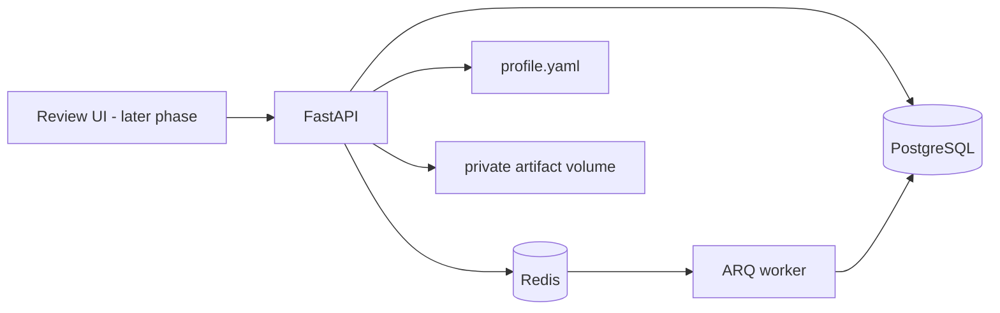

# Job Application Agent

Phases 1 and 2 establish a local foundation and public ATS job discovery workflow for an application system that uses verified profile facts and requires explicit human approval before submission. Employer verification, document generation, the review dashboard, and ATS submission are future phases.

## Architecture

PostgreSQL is the durable record; Redis is the queue/cache layer. ARQ was selected for the initial workload because it is async-native and uses the Redis service already required, with fewer operational components than Celery. Queue jobs must remain safe to retry; consequential workflow state is persisted in PostgreSQL.

## Project layout

`app/domain` contains Pydantic workflow contracts and transition rules; `app/db` contains persistence models; `app/profile` loads the authoritative YAML profile; `app/audit` redacts audit payloads; `app/discovery` contains public ATS source adapters, freshness checks, URL normalization, and persistence; `app/matching` contains deterministic scoring; `app/workers` configures ARQ; `migrations` contains schema migrations; `tests` contains deterministic fixture tests. Later phases add verification, documents, approval, submission, tracking, and dashboard modules.

## Local setup

Requirements: Docker Desktop with Compose. Python 3.12 is needed for running tests outside Docker.

1. Copy `.env.example` to `.env` and replace `APP_SECRET_KEY` with a long random value.
2. Populate `profile.yaml` with verified facts. Keep personal profile files out of source control when practical.
3. Start services: `docker compose up --build -d`
4. Apply schema: `docker compose exec api alembic upgrade head`
5. Check API liveness: `http://localhost:8000/health/live`; readiness: `http://localhost:8000/health/ready`.
6. Stop services: `docker compose down`.

Database and Redis data persist in Compose volumes. To reset a development database and queue, `docker compose down -v` removes those named volumes and their data.

For local Python setup, create a Python 3.12 virtual environment, then run `python -m pip install -e '.[dev]'`. Apply migrations with `alembic upgrade head`; run tests with `python -m pytest`.

## Discovery and matching (Phase 2)

Configure public job boards using `DISCOVERY_BOARDS` in `.env`, with semicolon-separated entries such as `greenhouse:acme;lever:acme;ashby:Acme`. A board token/site/board name must be known; these endpoints do not provide cross-employer search. The ARQ worker runs configured board discovery at startup and daily at 07:00 UTC. Only explicitly listed boards are queried. Workable's current documented job API requires an employer-generated API token with the `r_jobs` scope, so it is not treated as a generally public source in this release.

Greenhouse's public Job Board API supports unauthenticated GET requests for published jobs and descriptions. The adapter uses `first_published` when the board supplies it and never treats `updated_at` as publication time. Lever's public Postings API returns published postings but its documented response does not specify a publish timestamp, so those dates remain unknown. Ashby's public Job Postings API supplies `publishedAt`. Unknown or older dates are excluded. Posting pages are live-checked only when they use supported ATS hosts; redirects and unknown hosts are excluded pending a safe verification path.

The deterministic match score considers skill overlap, target role, experience/seniority, workplace/location preferences, work-authorization evidence when the location gives a direct country match, and compatible disclosed salary. It returns an explanation, matched/missing profile skills, and explicit conflicts. Unknown job data remains uncertain. The score is a ranking aid and does not decide whether an application is submitted.

Official source documentation: [Greenhouse Job Board API](https://docs.greenhouse.io/job-board), [Lever public Postings API](https://github.com/lever/postings-api), [Ashby Job Postings API](https://developers.ashbyhq.com/docs/public-job-posting-api).

## Phase 1 foundation

Included: Docker services for FastAPI, PostgreSQL, Redis, and ARQ; environment-backed settings; foundational database entities and migration; Pydantic profile and workflow models; explicit state transition validation; redaction helper for audit payloads; liveness/readiness endpoints.

Not yet included: authenticated review UI, employer verification scoring, LLM providers, document renderers, submission adapters, reminder scheduling, and production secrets/session management. No real job application is submitted by the system in these phases.

## Security and operations

Do not commit `.env`, populated profile data, generated documents, or browser evidence. Artifacts are mounted to a private Docker volume. Audit payloads redact keys resembling secrets and mask email addresses, but callers must still minimize payloads. Audit append-only behavior is an application convention in this phase; database-level tamper-evidence and retention controls remain future hardening work. Back up PostgreSQL and the artifact volume together, and test restore procedures before relying on the system.

External source terms, provider APIs, ATS forms, and access rules will be checked when each integration is implemented. Automated verification can evaluate a posting's evidence; it cannot guarantee that an employer is trustworthy.

